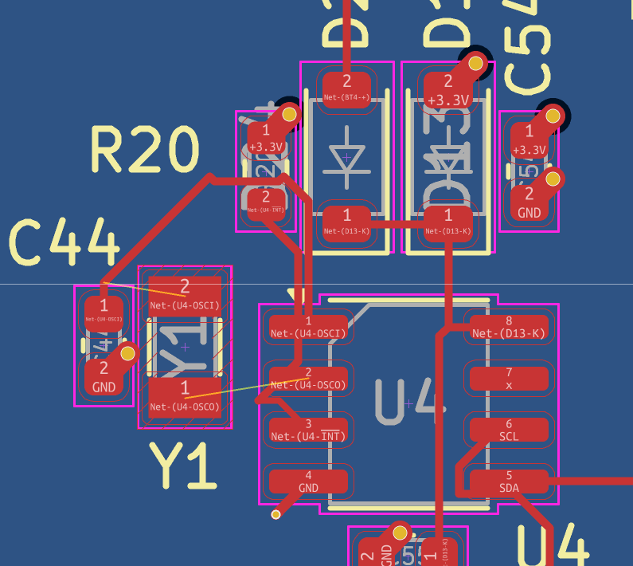

> **Shipped with the kicad-routing skill (1.17.0).** Draft 1.1 by Vladimir Duk for the skill maintainer, kept
> as written. Paths to `trial_tools\` and to the trial folder refer to the BladeOne trial machine; those prototype
> tools are not part of the skill. "Entry N" refers to the improvements proposal of 2026-09-25, implemented in
> skill 1.16.0 (see `CHANGELOG.md`). `kicad-golden` is the former name of this skill.

# kicad-golden 1.16.0 — BladeOne 0.1 routing trial: findings and caveats

| Field | Value |
|---|---|
| Date | 2026-09-28 |
| Board | BladeOne 0.1 (20260911 pinout), KiCad 10 format `20260206`, 169 footprints, 100 × 170 mm |
| Trial folder | `C:\_WORK\_CLAUDE_AI\20260924_BLADEONE\20260928_BLADEONE_Trial_V1_16\` |
| Skill under trial | kicad-golden 1.16.0 — **local implementation**, not an official release (see Section 3) |
| Prepared for | Celso Souza, skill maintainer |
| Prepared by | Vladimir Duk, with Claude Code |
| Status | Compliance review against the installed skill, `MANUAL.md`, all reference files and the improvements proposal completed (Section 8). Geometry and DRC verification of the board pending (Section 11). |

## 1. Purpose and scope

This document records the first routing trial of BladeOne 0.1 with the local 1.16.0 build of the skill. It
covers the environment preparation, the board preparation, the routing and repair passes, the defects found in
visual review, the deviations from the skill's own procedure, the errors found in the new tooling, and the
KiCad 10.0.3 behaviours that the skill does not yet document.

Errors made during the trial are recorded as they occurred. Numbers are copied from the tool output of the
session.

## 2. Summary of outcome

| Item | Result |
|---|---|
| Routing completion (`route_report.py`) | 89.43 % — 37 unrouted connections, 34 unstitched plane pads, 0 invalid via padstacks |
| Golden audit | 307 FAIL, 338 WARN, 19 INFO |
| KiCad DRC (`kicad-cli pcb drc`) | **Not executed** |
| Visual review | Performed by Vladimir after the session report; basic defects found (Section 7) |
| Deliverable status | **Does not meet** the standard. The board is not a deliverable in its current state. |

The session reported "89.4 % complete" before any DRC or visual check. Completion percentage counts ratsnest
connections only, and SKILL.md states explicitly that completion is not correctness. Presenting that figure as
the status was a procedural error.

For comparison, the improvements proposal's own trial on the same board reports 98.3 % (6 open) with the 1.15.0
skill and 96.3 % (13 open) with its hand-applied rules. This trial is worse than both: 89.43 % (37 unrouted).
Section 8 lists the procedural deviations that are the probable causes.

## 3. Status of the local 1.16.0 implementation

The eleven entries of `kicad-golden-improvements.md` (2026-09-25) were implemented in the installed copy at
`%USERPROFILE%\.claude\skills\kicad-golden`, starting from the 1.15.0 zip. This copy is not synchronised with
the maintainer's source.

**Files changed or added:** `SKILL.md`, `CHANGELOG.md`, `INSTALL.md`, `references/07_review_decisions.md`,
`templates/kicad_golden.project.json`, `scripts/kicad_audit.js`, `scripts/route_freerouting.py`,
`scripts/route_finish.py` (docstring only), `scripts/fab_layer_fix.py` (new), `scripts/geometry_finish.py`
(new), `tests/run_tests.js`.

**Test suite at the end of the implementation:** 110/110 (`run_tests.js` 53, `run_tests_py.py` 22,
`run_tests_boards.py` 8, `run_tests_phased.py` 11, `run_tests_rules.py` 16).

**Changes made after that test run, during the trial, and not covered by any test run:**

- `fab_layer_fix.py`: save and reload between adding and centring Fab references; bounding-box sanity gate.
- `geometry_finish.py`: bounding-box sanity gate and skip-if-present for crystal/inductor keepouts;
  `MIN_SEG_MM` and 45° lattice validation before any board mutation in `shift_isolated_segment`,
  `--neck-pad-entries` and `--pad-centre-entries`.

### 3.1 Conformance of the implementation to the improvements document

| Entry | Audit severity specified | Implemented | Verdict | Remark |
|---|---|---|---|---|
| 1 Fab values | WARN | WARN | Meets | |
| 2 Fab references | WARN off-centre or beyond outline | WARN off-centre only | Partially meets | "Beyond outline" not checked: no glyph metrics available |
| 3 Centring between footprints | WARN | **FAIL** | Does not meet | Severity raised above specification. Accounts for most of the 210 `between-pads` FAILs |
| 4 Centring under two-pad part | WARN | **FAIL** | Does not meet | Same check as entry 3 |
| 4 Crystal/inductor ban | FAIL | FAIL | Meets | See Section 5.8 for the keepout design error |
| 5 Pad-entry width | FAIL | FAIL | Meets | Possible conflict with the existing 0.2 mm minimum-entry-length WARN: the necked stub is short by design |
| 6 Shared pad gaps | FAIL / WARN by parameter | FAIL / WARN by parameter | Meets | |
| 7 Plane-net surface links | FAIL | FAIL | Meets | DSN filtering prevented all links in this trial |
| 8 Pad entry at centre | FAIL | FAIL; staircase raised WARN → FAIL | Meets | |
| 9 Axial entry | WARN | WARN | Partially meets | No automated axial correction |
| 10 Route around parts | WARN | WARN | Partially meets | `--route-around` reports only; no reroute |
| 11 Even spacing | WARN | WARN | Partially meets | Component outlines only, midpoint sampling, pads modelled as circles |

`route_finish.py` was not modified. Entry 8 is applied afterwards by `geometry_finish.py --pad-centre-entries`.

## 4. Environment preparation: findings

| Topic | Finding |
|---|---|
| Lessons-learned document items 2 and 3 | Recorded as "Done" in `BladeOne_Routing_Lessons_Learned.docx`, but absent on this machine. The status was machine-specific. |
| Installed | Temurin JRE 21.0.12.1 (winget); Freerouting 2.4.1 (MSI from the GitHub release, native launcher at `%LOCALAPPDATA%\freerouting`); shapely 2.1.2 and matplotlib 3.11.2 in KiCad's Python user site; Inkscape 1.4.4; Node.js 24.19.0 LTS |
| Node.js | Required by the skill (audit, settings), but not listed among the tool items of the lessons-learned document. Found missing by `doctor.py`. |
| winget | The `msstore` source asks for terms interactively and fails in a non-interactive shell. `--source winget` avoids it. |
| Inkscape | The installer does not add itself to `PATH`. Added to the user `PATH` manually; `doctor.py` then resolves `inkscape.COM`. |
| PATH in a running shell | A shell opened before an installer does not see the new `PATH`. Tools were called by full path until a new shell was opened. |
| Node working directory | Confirmed: Node tools must be started from a short directory (`%USERPROFILE%` was used). Long paths as arguments work. |

## 5. Board preparation: findings

### 5.1 Initial state of the board

KiCad 10 format, 169 footprints placed, 0 segments, 0 vias (the first inventory reported 3 in error; see
Appendix A). Only F.Cu and B.Cu were declared.
`fp-lib-table` absent; `sym-lib-table` listed only SYN470R out of about 13 libraries in `01-Biblioteca`.
`.kicad_pro` held a bare Default netclass and zeroed rules. No `kicad_golden.project.json`.

Decisions recorded with Vladimir: 4 layers; JLCPCB 1 oz outer / 0.5 oz inner; shared pad gaps not allowed;
library tables not rebuilt (routing only, placement trusted); +VSYS, GND_LED and +BATT routed as POWER_DC tracks,
without inner-layer islands; legacy B.Cu GND pour kept as a secondary pour.

Two of these decisions rested on incorrect advice from the session (Section 8, items M3 and S6). Keeping the
B.Cu pour contradicts `MANUAL.md` §2.4 and §2.9 and `02_routing_geometry.md` §3.9. The reason given for
treating the three minor rails as tracks — the split-plane prohibition — applies to interleaved BGA/FPGA rails,
not to this board, and its required proof was not computed.

### 5.2 Conversion from 2 to 4 copper layers

No script in the skill changes the layer count; `init_project.py` only warns on a mismatch.
`pcbnew.SetCopperLayerCount(4)` with `SetLayerType(..., LT_POWER)` updates the `(layers ...)` table but leaves
the `(setup (stackup ...))` block describing a 2-layer board. The stackup was edited as text: F.Cu 35 µm, prepreg
0.1 mm, In1.Cu 17.5 µm, core 1.24 mm, In2.Cu 17.5 µm, prepreg 0.1 mm, B.Cu 35 µm. The board file uses CRLF line
endings; the first text replacement failed on that and was corrected.

### 5.3 Fab-layer hygiene (entries 1 and 2)

Counts before the fix matched the improvements document's own test: 165 visible values, 11 off-centre
references, 7 footprints without a Fab reference.

The first run of `fab_layer_fix.py --all` saved 11 references (D11, R5, D10, U5, J3, SW2, J4, U11, U8, SW3, SW1)
at positions 900 to 2100 mm from their footprints. The cause was a KiCad-internal int32 overflow in bounding-box
computation (Section 9). The board was restored. A save and reload between the add and centre passes did not
remove the overflow. A sanity gate was then added: any bounding box wider or taller than 500 mm, or centred more
than 100 mm from the footprint origin, is rejected and the reference is left unmoved.

Result: 165 values hidden; 10 references added; 9 centred or resized; **24 references left unmoved** by the
gate; AE1 does not fit at the 0.3 mm floor; 14 off-centre references remain. The overflow hit 11 footprints in
the first run and 24 in the second, so the set of affected footprints is not stable between runs.

`fab_layer_fix.py` writes no backup before saving, unlike `repair_import.py` and `route_freerouting.py`.

### 5.4 Edge.Cuts

The outline is a single 100 × 170 mm rectangle with no duplicates. Stroke corrected from 0.1 to 0.05 mm. Three
dimension objects (90 mm, 5 mm, 5 mm) sat on Edge.Cuts, which is the trap documented in 1.14.2. They were moved to
User.1.

### 5.5 Hand-drawn copper

A `PCB_SHAPE` on F.Cu carrying net `Net-(D10-A1)` was still on the board. It is the same item described in the
1.14.1 changelog entry: that entry documented the hazard, but the board itself was never corrected. It was
converted to a track. Its endpoint sat 12 µm from the centre of FB1-1 and was snapped.

### 5.6 Planes

GND on In1.Cu at priority 1 and +3.3V on In2.Cu at priority 0, both inset 0.5 mm from the outline. The legacy
B.Cu GND pour was kept and its clearance changed from 0.5 to 0.1 mm.

### 5.7 Duplicate reference designators

Three logo footprints carried the literal reference `G***`. With them present, `ExportSpecctraDSN` returned
False and printed nothing. `route_freerouting.py` reported only "ExportSpecctraDSN returned False". The logos were
renamed G1 to G3 and set to exclude from BOM.

### 5.8 Crystal and inductor keepouts (entry 4 exception)

- **Design error.** A KiCad rule area with tracks not allowed blocks every net, including the part's own.
  Entry 4 requires that "the only tracks allowed there are the ones connecting to the part's own pads", and
  suggests covering the courtyards with keepout rule areas. A plain rule area cannot meet both conditions.
  After routing, the own connections of every protected part were unrouted. From the Freerouting log:
  Y1-1 → U4-2, C44-1 → Y1-2, Y2-1 → U8-15, C3-1 → L1-1, L2-1 → C3-2. The unrouted Y1 connections are visible in
  the image in Section 7. This needs a maintainer decision, for example a keepout with openings for the own pads,
  a custom DRC rule, or treatment at DSN level.
- The same int32 overflow corrupted two of the six keepouts created (KO_L3, KO_L4: width −497 mm, height
  2147.483 mm, the int32 signature in nanometres). Both were removed and a sanity gate was added. L3 and L4 are
  left without a keepout. After routing, +VSYS crosses the courtyard of L3.
- `stitch_planes.py` placed GND vias inside three of the keepouts (L1, L2, Y2): 6 keepout FAILs. It does not read
  rule areas.

### 5.9 pcbnew project cache

Every pcbnew script that saved the board rewrote `.kicad_pro` from memory. The tuning-pattern `corner_style`
reverted from 2 to 1 after each such save. `apply_settings.js` must be the last writer of `.kicad_pro`. The final
audit still shows the three `corner_style` WARNs.

### 5.10 Clearance left raised after a failed export

The first `route_freerouting.py --auto-clearance` run raised the Default and POWER_DC netclass clearance from
0.10 to 0.15 mm, then stopped at `ExportSpecctraDSN` (Section 5.7) before restoring it. The error path exits
without the restore. The second run found the clearance already at 0.15 mm. The final audit still reports
`netclass Default.clearance = 0.15` and `POWER_DC.clearance = 0.15`.

## 6. Routing and repair: findings

### 6.1 Pre-flight

`route_report.py`: 350 connections; one footprint-local clearance override (U6, 0.150 mm, VQFN-29); 22 long-haul
nets; 134 unstitched plane pads (+3.3V 42, GND 92).

### 6.2 Freerouting

| Item | Value |
|---|---|
| Command | `route_freerouting.py --auto-clearance --passes 300 --timeout 3600 --auto-rules` |
| Elapsed | 749.7 s |
| DSN | Plane nets +3.3V and GND filtered out (kept 137 nets, dropped 2); via cost 50 from the generated `.rules` file |
| Result | 203 unrouted nets at start; 12 unrouted and 4 violations at the end; 1 → 833 tracks |
| Optimizer | 11 threads by default. Freerouting warns that multi-threaded optimization generates clearance violations and recommends `-mt 1`. `route_freerouting.py` passes `-mt` only when `--threads` is given. The recommendation was not applied. |
| Long-haul nets | Not routed first, contrary to the pre-flight instruction |
| Clearance sweep | `route_sweep.py` not run |

### 6.3 Post-import repair

`repair_import.py` added the Q-06 flags to 81 vias. Width histogram before repair: 0.15 mm × 39, 0.2 mm × 652,
0.2002 mm × 3, 0.2402 mm × 1, 0.45 mm × 2, 0.6 mm × 55. The non-standard widths are Freerouting neckdowns.

### 6.4 Defect in `geometry_finish.py` found on the real board

The first `geometry_finish.py --all` run introduced 88 zero-length segments; the audit rose to 431 FAIL. No
operation checked the length of the segments it produced. After a 10 µm minimum length and a 45° lattice check
were added, both applied before anything is removed from the board, the zero-length segments disappeared.
`--pad-centre-entries` showed the largest drop in accepted operations (109 → 21), which identifies it as the main
source. The board was restored from `.bak_prerepair` and the repair pipeline was run again.

The synthetic fixtures did not expose this defect: it appeared only on dense real geometry (the capacitor
clusters around U6 and U7).

`geometry_finish.py` writes no backup before saving.

### 6.5 Second repair run

73 gaps re-centred; 105 left for manual attention (multi-branch or pad-touching); 4 entries necked; 21 entries
snapped to pad centre; 34 tracks spread; 0 plane-net links; 6 shared pad gaps. Plane stitching: 108 vias placed,
26 skipped for lack of a clear position.

### 6.6 Final audit

| Check | FAIL | Principal cause |
|---|---|---|
| between-pads | 210 | Dense multi-branch topology; severity raised above specification (Section 3.1) |
| pad-entry | 42 | Residual entries beyond the safe scope of the fixers |
| width | 37 | 0.15 mm neckdowns outside a recognised fine-pitch escape |
| shared-gap | 9 | Router placed two nets in one gap (e.g. LORA_CLK and LORA_CS at U5-3/U5-4; adjacent J3 pins) |
| keepout | 6 | Stitching vias inside the L1, L2 and Y2 keepouts (Section 5.8) |
| crystal-inductor | 2 | +VSYS crosses L3's courtyard (no keepout, Section 5.8) |
| angle | 1 | Net-(U6-SW2), 0.046° off lattice; origin not established |
| **Total** | **307** | |

### 6.7 Inconsistencies in the tooling

- `geometry_finish.py` reported 0 route-around candidates while the audit reported 111. Two probable causes, not
  verified: an `elif` makes the recording unreachable whenever centring runs; `GetParentFootprint() is ...`
  compares SWIG proxy objects by identity.
- Several `between-pads` and `spreading` messages report negative clearances (for example U6-21 / C12-1
  −0.4001 mm; LORA_CS −1.4882 mm). They are either real overlaps or artefacts of the approximations (rotated-pad
  reach model; pads modelled as circles). Only DRC can decide, and DRC was not run.
- The audit header prints version 1.15.0: `golden_settings.json` → `_meta.skill_version` was not updated.
- Unrouted counts were not reconciled: Freerouting reported 12; `route_report.py` reported 37 after repair and
  stitching.

## 7. Defects identified in visual review

*Image 1: the RTC area around U4 and Y1, as reviewed by Vladimir.*

Observations from the image. They have not yet been checked against a geometry dump or DRC; the dump was stopped
at Vladimir's request before it ran.

- Y1 is not connected: ratsnest lines remain from C44-1 to Y1-2 and from Y1-1 to U4-2. This is a direct
  consequence of the keepout design error in Section 5.8.
- Net-(U4-OSCI) runs from C44-1 to U4-1 by a long detour above the parts, between the pads of R20, instead of
  the short path through Y1.
- A Net-(D13-K) track appears to run vertically under U4, between its two pad columns.
- Several tracks converge along the left pad column of U4, pins 1 to 3.
- Crystal nets must be short, with the load capacitors adjacent. The autorouter has no notion of this. Crystal
  and oscillator nets should be routed by hand, or as critical nets in phased routing, before the autorouter
  runs.

## 8. Compliance review of the trial against the skill

After the trial, the installed `SKILL.md`, `MANUAL.md`, all files in `references/` and the improvements
proposal were read in full and compared with what was done. `MANUAL.md` and several reference files had not
been read before the trial. `SKILL.md` directs a first-time user preparing a board to read `MANUAL.md` first.
Several of the findings below would have been avoided by that reading alone; in particular, `MANUAL.md` §2.4
already describes this board's 2-layer-to-4-layer history, including the stackup rewrite and the removal of the
B.Cu ground pour.

Verdict column: **Meets**, **Partially meets**, **Does not meet**.

### 8.1 MANUAL.md

| # | Requirement | Verdict | What was done |
|---|---|---|---|
| M1 | §2.1 Close KiCad before any script writes `.kicad_pcb` / `.kicad_pro` | Does not meet | Never confirmed with Vladimir |
| M2 | §2.3 Run DRC before routing and review courtyard overlaps | Does not meet | DRC not run at any stage |
| M3 | §2.4 / §2.9 A B.Cu ground pour is redundant once In1.Cu carries GND and eats routing space; on this board it was discarded in the earlier conversion | Does not meet | The session recommended keeping it; the pour was present on B.Cu during the DSN export. Its effect on the result was not measured. `02_routing_geometry.md` §3.9 also forbids zones on signal layers that compete with routing corridors |
| M4 | §2.7 Decide whether each footprint-local clearance override is needed, because `--auto-clearance` raises the clearance of the whole board | Does not meet | The U6 override (0.15 mm) was applied without putting the decision to Vladimir |
| M5 | §2.8 Confirm `items_not_allowed` is not `ignore` | Meets | Verified after the trial: `error` |
| M6 | §2.9b Freerouting settings no script can reach: vias snap to SMD pad centres, automatic neckdown, drag components; pad-to-turn gap ≥ 200 µm | Does not meet | Not raised with Vladimir. Automatic neckdown remained at its default; the 39 segments at 0.15 mm behind the `width` FAILs are the expected consequence |
| M7 | §3 Default single pass: `route_sweep.py --passes 100 --threads 1 --keep-all` | Does not meet | One run of `route_freerouting.py` at 300 passes, 11 optimizer threads, no clearance sweep |
| M8 | §5 After the run: finish remaining connections with `route_finish.py`, re-run DRC to zero, re-apply `corner_style` last, generate outputs | Not reached | |

### 8.2 SKILL.md

| # | Requirement | Verdict | What was done |
|---|---|---|---|
| S1 | §0 step 1: ask layer count, copper weight and shared-gap policy in one interaction | Meets | |
| S2 | §0 step 2: when web access exists, re-check the JLCPCB capabilities page before applying the profile | Does not meet | Profile captured 2026-09-17 used without re-checking |
| S3 | §0 steps 3, 5, 6: via-drill harmonisation, immutable 4-layer order, every net in a netclass | Meets | |
| S4 | Edge.Cuts Sanitization step 5: report item count before and after, polygon vertex count and bounding box | Partially meets | Corrections made; the verification statement was not produced |
| S5 | Keepout Enumeration: state the count explicitly, confirm `items_not_allowed`, state the measured margin | Partially meets | The audit printed the count (3, all footprint-internal); none of the three statements was made to Vladimir before routing |
| S6 | Complex Power Plane Splits: prove the prohibition applies (pad bounding boxes, orphan count) before invoking it | Does not meet | Invoked for +VSYS, GND_LED and +BATT without proof. The prohibition addresses interleaved BGA/FPGA rails, which BladeOne does not have |
| S7 | Routability Pre-Flight item 2: route long-haul nets first | Does not meet | Single pass |
| S8 | Choosing the clearance: measure with `route_sweep.py` | Does not meet | Not run |
| S9 | Mandatory post-import repair: remove neckdowns and restore the netclass width; snap off-lattice endpoints; quantify the repair | Does not meet | No step removed neckdowns (`repair_import.py` only raises widths below `min_track_width`); 37 `width` FAILs and 53 `width` WARNs remain. No off-lattice snapping |
| S10 | Post-Routing Geometric Refinement: re-run `kicad_audit.js` after every flag and revert a regression | Does not meet | `--all` in one pass; the regression was found afterwards |
| S11 | Plane stitching: widen the search before accepting "no clear position" | Does not meet | 26 skipped pads accepted as reported |
| S12 | Hand-drawn copper: after routing run `kicad-cli pcb drc` and check `shorting_items` | Does not meet | Not run |
| S13 | Verify Visually: render the layers and inspect them | Does not meet | Not performed before reporting |
| S14 | Workflow step 3: read every WARN and fix it or state why it is accepted | Does not meet | 338 WARNs not reviewed |
| S15 | Completion percentage is not correctness | Does not meet | 89.4 % reported as the status |
| S16 | Tooling policy: run the test suite after any change to the scripts | Does not meet | Scripts changed during the trial without a test run |
| S17 | Act on router output; Freerouting's own log recommends `-mt 1` | Does not meet | Warning noted in the report but not acted on |

### 8.3 Reference files

| # | Requirement | Verdict | What was done |
|---|---|---|---|
| R1 | `02` §3.4: when a keepout forbids vias, keep via centres at least `min_clearance` outside it | Does not meet | `stitch_planes.py` placed vias inside the L1, L2 and Y2 keepouts |
| R2 | `02` §3.10: custom footprints in a project-local `.pretty` registered with `${KIPRJMOD}` | Does not meet (board) | `fp-lib-table` absent; left as is by decision, recorded here as an open non-conformity of the board |
| R3 | `02` §3.10: logos `exclude_from_bom` and `exclude_from_pos_files` | Partially meets | G1–G3 set `exclude_from_bom` only |
| R4 | `02` §3.11 / Q-14: references hidden on silkscreen | Does not meet | 109 references visible; the question was not put to Vladimir |
| R5 | `02` §3.2: never leave zero-length segments | Does not meet (first repair run) | 88 created by `geometry_finish.py`, removed by the restore (Section 6.4) |

### 8.4 Improvements proposal ("Where it goes" sections)

Beyond the severity deviations in Section 3.1:

| # | Proposal | Verdict | What was implemented |
|---|---|---|---|
| P1 | Entry 3: centring in `repair_import.py`; `route_finish.py` centres its own tracks | Partially meets | Centring in `geometry_finish.py` only |
| P2 | Entry 6: if not allowed, reroute one squeezed track; keep the reroute only if DRC does not get worse and it adds at most two vias | Does not meet | Reported only |
| P3 | Entry 7: `route_finish.py` mode to connect a pad to the nearest same-net via | Does not meet | Not implemented |
| P4 | Entries 8 and 9: `route_finish.py` ends on the pad centre and tries the axial approach first; a repair step re-enters 45° entries axially | Partially meets | Post-hoc snap in `geometry_finish.py`; no axial re-entry |
| P5 | Entry 10: report the detour length each remaining under-part track would have needed | Does not meet | Not computed |
| P6 | Test boards: entry 2 reference wider than its outline; entry 8 jog inside the clearance area and straight 45° entry that must pass | Does not meet | Not added |

### 8.5 Inconsistencies in the skill text

- `02_routing_geometry.md` §3.5 and `04_verification_and_checklist.md` step 9 still describe the pre-rev-P
  pad-entry rules: 0°/90° relative entry only, the ≥ 2 mm off-centre exemption, and "never neck down at a pad".
  They contradict entries 5, 8 and 9. The files state that the review decision wins, so the conflict is
  resolved formally, but the text is stale.
- `05_decision_rules.md` D2 ("step down once, at the last corner, ≥ 1 mm before the pad") conflicts with entry 5
  ("step down before crossing the clearance outline").
- `templates/kicad_golden.project.json` ships `via_in_pad.allowed_refs` = U1, U3, IC3, although its own note
  says every list starts empty. BladeOne has a U1 and a U3. `init_project.py` did not copy the list (verified),
  but Workflow step 1 of `SKILL.md` says to copy the template.

### 8.6 Root causes

1. The trial started without reading `MANUAL.md` and most reference files.
2. The documented default workflow (clearance sweep, one optimizer thread, long-haul nets first) was replaced by
   a single faster pass.
3. New and untested tooling was applied to the real board in one pass, without an audit between steps.
4. No independent check (DRC, render) was made before the result was reported.

## 9. KiCad 10.0.3 pcbnew behaviour not documented in the skill

- `FOOTPRINT.Fields()` does not exist; `GetFields()` does. `Value()` and `Reference()` return `PCB_FIELD`.
- `fp_text user` items appear in `GraphicalItems()` as `PCB_TEXT`.
- `${REFERENCE}` is resolved only by `GetShownText(True)`; the argument is required.
- `EDA_TEXT.GetTextBox()` requires a rendering-settings argument, so glyph metrics are not available from a
  script.
- `ZONE.SetDoNotAllowZoneFills` is the correct name; `SetDoNotAllowCopperPour` does not exist.
- Dimension objects are class `PCB_DIM_ORTHOGONAL` and are returned by `GetDrawings()`.
- `GetStackupDescriptor()` returns an opaque object; the stackup cannot be edited from Python.
  `SetCopperLayerCount()` does not update the stackup.
- **int32 overflow in bounding-box computation.** On this board, `kimath` asserts "Overflow converting value
  … to int" during bounding-box work on some footprint courtyard and Fab shapes. The returned values are finite
  but absurd (up to about 2147.483 mm, the int32 limit in nanometres). The set of affected footprints changes
  between runs. The process then exits with code 5 even when the script completed. Every script that uses a
  bounding box needs a sanity gate.
- The board file uses CRLF line endings; text edits must preserve them.
- "Adding duplicate image handler" messages at load time are harmless.

## 10. Recommendations for the maintainer

Listed in order of priority.

1. Replace the crystal/inductor keepout approach with one that allows the part's own nets (Section 5.8).
2. Extend the pre-flight gate with three checks: unique reference designators, net-carrying shapes on copper
   layers, and dimension objects on Edge.Cuts. All three were live on this board and none was caught
   automatically.
3. Add a layer-count conversion tool that updates both the layer table and the stackup.
4. `route_freerouting.py`: restore the netclass clearance in a `finally` block; pass `-mt 1` by default; when
   `ExportSpecctraDSN` returns False, report the probable causes (duplicate references first).
5. Make `fab_layer_fix.py` and `geometry_finish.py` back up the board before saving, as the other scripts do.
6. Move the bounding-box sanity gate into a shared helper and use it everywhere a bounding box is used.
7. Return `between-pads` to WARN as specified, or confirm that FAIL is intended.
8. Make `stitch_planes.py` respect rule areas.
9. Fix the route-around counting in `geometry_finish.py` (Section 6.7).
10. Update `golden_settings.json` → `_meta.skill_version` to the released version.
11. Make DRC and a visual render mandatory workflow steps before any statement of completion.
12. Route crystal and oscillator nets by hand, or as critical nets in phased routing, before autorouting.
13. Add BladeOne to `tests/corpus` so the fixers are exercised on real, dense geometry.
14. Settle the conflict between the entry 5 neck stub and the 0.2 mm minimum entry-length WARN.
15. Provide the neckdown-removal step that the mandatory post-import repair requires; no script does it today.
16. Update `02_routing_geometry.md` §3.5, `04_verification_and_checklist.md` step 9 and `05_decision_rules.md`
    D2 to the rev P pad-entry rules (Section 8.5).
17. Empty `via_in_pad.allowed_refs` in `templates/kicad_golden.project.json`, as its own note requires.
18. Make the start of a routing run explicit in `SKILL.md`: read `MANUAL.md` §2 and the reference files, confirm
    KiCad is closed, and put the §2.7 and §2.9b decisions to the user before the first export.

## 11. Pending items

- Geometry dump and DRC of the U4 / Y1 region, to confirm or correct the observations in Section 7.
- Second routing run from the original, unrouted board, following the full workflow of Section 8 (decided
  2026-09-28). `.bak_prerouting` was rejected as the restart point: it already contained the B.Cu pour, the
  flawed keepouts and the partial Fab fixes, it predates the G*** rename, and it does not cover `.kicad_pro`.
- Synchronisation of the local 1.16.0 changes with the maintainer's source (Section 3).

## 12. Second run: starting point and decisions

Started 2026-09-28 from the original delivery, verified byte-identical to the archive (Appendix A). KiCad,
pcbnew, eeschema and Freerouting were confirmed closed from the process list before any step.

| Topic | Decision | Basis |
|---|---|---|
| Conversion to 4 layers | Performed by Vladimir in Board Setup (layer count, In1.Cu/In2.Cu typed `power`, stackup 35 / 17.5 µm) | `MANUAL.md` §2.4; avoids the scripted stackup edit of Section 5.2 |
| U6 local clearance override (0.15 mm) | Removed; board routes at the 0.10 mm rule | Vladimir's decision (`MANUAL.md` §2.7). The clearances around U6 are to be checked in DRC after routing, since the value came with the TI footprint |
| Crystal/inductor rule (entry 4) | No keepouts. The own nets of Y1, Y2 and L1–L4 are routed by hand first and locked; other nets under these parts are found by the audit and rerouted | Avoids the design error of Section 5.8 |
| Freerouting settings not reachable by script (`MANUAL.md` §2.9b) | Scripted clearance sweep with Freerouting defaults; neckdowns widened afterwards by a new step, tested on a copy before use, audit after it | Vladimir's decision |
| B.Cu GND pour | Removed | `MANUAL.md` §2.9; `02_routing_geometry.md` §3.9 |
| Edge.Cuts, hand-drawn copper, G*** references | Corrected as in Sections 5.4, 5.5 and 5.7 | `SKILL.md` pre-flight sections |
| Schematic-to-PCB sync | Initially not performed (library tables absent). Revised after the parity check of Section 12.1 found 24 conflicts on U2, R16, R51 and R52: the schematic is taken as correct, and Vladimir runs Update PCB from Schematic for nets only, with footprint replacement and deletion disabled | Decision of the first run, revised by Vladimir on 2026-09-28 |
| Dangling stub | The converted `Net-(D10-A1)` line connected none of the net's three pads (FB1-1, D10-1, F1-2); removed so the board starts with zero copper | Pre-route DRC `track_dangling` |
| Power-path netclass | New class HIGH_CURRENT, 1.0 mm, clearance 0.1 mm, via 0.6 / 0.3. Assigned by exact-name pattern to +VSYS, +BATT, VBUS (`Net-(Q3-D)`), PMID, the two input paths (J4/J5 → F1/F2 → FB1/FB2, including `24V_SENSE` and `SOLAR_SENSE`), the FET common-source nodes, the battery path (BT1/BT2 → F4/F5 → SW1, `Net-(U9-GND)`) and the four switch nodes | Currents from the project's own design notes: BQ25798 charge current up to 5 A, notes recommend 1.75–3.5 A; SYS input up to 3.18 A; fuses F4/F5 2 A per cell |
| Switch nodes | Local F.Cu pours for U6 SW1/SW2 ↔ L3 and U7 L1/L2 ↔ L4 | Vladimir's decision |
| C14 placement | Moved from (87.000, 96.000) to (88.200, 96.000), same rotation, after a preview on a scratch copy. Opens a 2.25 mm gap over U6 pins 28/27/26, so SW1 and SW2 reach L3 directly; SYS keeps its existing ~0.43 mm neck under C14 | Lessons-learned item 7 (U6 placement); Vladimir's decision |
| `between-pads` false FAILs on pad exits and entries | The checker was corrected in the local skill (1.16.0-local.1) and the tests extended, instead of recording the FAILs as deviations. Severity kept at FAIL | Vladimir's decision, 2026-09-28 (Section 12.1) |
| U7 PGND (pin 3) | Tied on F.Cu to the U7 exposed pad, in addition to its own via; recorded in `plane_net_exceptions` | Vladimir's decision, 2026-09-28 (Section 12.2) |
| Gap definition for between-pad centring | Between different parts, or within a multi-pad part, a gap is at most 1.5 mm of free copper-edge width; any width counts under a two-pad part. REFOSC was also centred between Q7-1 and U8-16 | Vladimir's decision, 2026-09-28 (Sections 12.1, 12.3) |
| Long-haul nets | Phased routing (opt-in). Phase 1 routes +VSYS, +BATT, `Net-(SW1-A)`, `24V_SENSE` and `GND_LED`, followed by repair, audit and lock; then the three-candidate clearance sweep for the remaining nets. Recorded in `priority_routing.critical_nets` | Vladimir's decision, 2026-09-28; smallest set, per the skill's measured observation on phasing |
| Bootstrap branches SW1 → C13-1 and SW2 → C12-1 | 0.5 mm, below the HIGH_CURRENT 1.0 mm width, because of the space between the caps and the pins; both carry only the bootstrap charge current | Engineering choice made during routing, not separately decided by Vladimir; recorded as a width deviation (Sections 12.2, 12.3) |
| RF matching network width | Default 0.2 mm; no controlled-impedance reference recorded (Q-13) | Engineering choice made during routing; **open for confirmation** by Vladimir |
| U2 DNP flag | Board marks U2 DNP, schematic populates it; not carried by the update | **Open**, left to Vladimir (no effect on routing) |
| U6 left-side escape (REGN pin 5, VAC1 pin 8) | The hand-routed BTST1 vertical had closed the only escape of pins 5 and 8 (Section 12.4). BTST1 stays on F.Cu over GND, moved to x 82.683; REGN and VAC1 drop to B.Cu through one 0.25/0.15 via each beside it | Vladimir's decision, 2026-09-28 |
| U6 BAT pins 22/23 (+BATT) | F.Cu pour on the pins with two 0.6/0.3 vias (the space admits no more, about 3–4 A), one 0.6/0.3 via for R8-2, and a 1.0 mm B.Cu link to the phase-1 +BATT trunk. Sufficient for the recommended 1.75–3.5 A charge current; **below the 5 A maximum** of the design notes | Vladimir's decision, 2026-09-28 |
| Centring against a via | An other-net via counts as a flank, measured from its binding keep-out: copper + 0.1 mm, or hole + 0.254 mm (JLCPCB hole-to-copper), whichever is larger. A track is centred in the channel it may actually use | Vladimir's decision, 2026-09-28 (checker change, Section 12.1) |
| PMID link (C33 ↔ C34/C35) | The hand-routed SW1 bootstrap branch crosses the direct F.Cu line between C33-1 and the other PMID capacitors. A B.Cu link with vias was decided, but it proved impossible when tried on a copy: the phase-2 router's Q3-D, ACDRV1 and ACDRV2 B.Cu diagonals run between C33 and C35, and the attempt produced 10 shorts. The design had been drawn from pad geometry without re-dumping the phase-2 copper, a method error of this trial; the real board was untouched. Superseded by the row below | Vladimir's decision, 2026-09-28; superseded |
| U6 surroundings (PMID, SOLAR_SENSE and related) | Route patching around U6 is stopped. A placement review of the U6 surroundings is prepared for Vladimir, covering the six routing problems traced to it; that zone is re-routed after his placement decisions. The centring step proceeds meanwhile, since it is independent | Vladimir's decision, 2026-09-28 |
| Boxed-in plane pads (stitching) | 13 pads with no stitching position got a straight or one-bend (45°) stub to a 0.6/0.3 via (`stitch_residual.py`), checked against true shapes, hole clearance and courtyards, and proven by DRC on a copy. U7-9 and U11-2 (GND pins beside their IC's exposed pad) were tied on F.Cu to that exposed pad, as U7-3, and listed in `plane_net_exceptions` | Engineering choice made during repair, following Vladimir's U7-3 decision; **open for confirmation** |
| Phase-2 centring FAILs (60 `between-pads`, router copper) | A new centring step is built instead of using `geometry_finish.py --center-gaps` (unsafe, Section 12.4). Requirements: skip locked copper, use the audit's own gap definition, check clearance before every move, and prove it on a copy with KiCad DRC. Cases it cannot fix safely are done by hand. Run after plane stitching, so the stitching vias are already present as flanks | Vladimir's decision, 2026-09-28 |
| Phase-2 export clearance | The sweep (0.10 / 0.15 / 0.20 mm) chose 0.10 mm, but at 0.10 mm the router leaves tracks 0.25 mm from the drill of the 0.45/0.15 Default via (0.10 + 0.15 mm ring), 2–4 µm short of the JLCPCB 0.254 mm hole-to-copper rule (11 warnings). Phase 2 is re-run at 0.105 mm, the smallest clearance the hole rule allows for that via, and kept if its completion matches | Vladimir's decision, 2026-09-28 |
| Facing test for gaps | Two flanks form a gap only if they face each other across the track: their offset along the track may not exceed the sum of their reaches in that direction. It removes the false FAILs where a long segment was paired with pads at opposite ends (+VSYS near R37, 12 mm apart), or with vias behind and beyond it (SW2 bootstrap branch) | Vladimir's decision, 2026-09-28 (checker change) |
| 24V_SENSE under D12 | The router's 1.0 mm diagonal under D12 (two-pad part, off-centre) is rerouted around: straight down between Q6's pins (centred), left through the Q6/D12 gap (centred), down midway between D12-1 and J5-1, then a 45° jog and a vertical 0.9 mm-necked entry into C32-1 | Vladimir's decision, 2026-09-28 (route-around, entry 10) |
| C14-1 (SYS capacitor) connection | With the L3 keepout the SYS island (U6 pin 25, the 0.4 mm band, C14-1) is enclosed on F.Cu. One 0.6/0.3 via on the band at (88.2, 96.79) takes it to B.Cu; phase 2 completes the link to the rest of +VSYS | Vladimir's decision, 2026-09-28 |
| **SYS current capacity (design-review item)** | The SYS path out of U6 is limited to **about 1 A** by the hand-laid 0.4 mm band (skill table D2: 0.6 mm ≈ 1.6 A), against up to 3.18 A in the design notes. The via (about 1.5–2 A) is not the bottleneck. A full-current SYS path needs a placement change at the U6 top edge (C14, C12, C24) | Found during the phase-1 redo; **open for Vladimir / Celso** |
| Crystal/inductor rule during autorouting | The first phase-1 result put +VSYS under L3 and GND_LED under Y2. Keepouts over the Y/L courtyards (F.Cu) are added to a scratch copy used only for the DSN export; the real board never holds them, so the own-net copper already inside causes no DRC error. Phase 1 is redone from the pre-phase-1 board, with the U6 escape fixes applied before routing, and the same keepouts are used for phase 2 | Vladimir's decision, 2026-09-28; revises the earlier "no keepouts" decision, whose reason (keepouts blocking the parts' own nets) no longer applies once those nets are hand-routed and locked |
| U6 bootstrap capacitors C12 / C13 (placement review, option A + B) | After the BQ25798 datasheet layout guidance was consulted (SLUSDV2C Section 8.4.1, item 2: "The BTST capacitors can be connected with vias on both sides"; the reference layout places them on the bottom layer), C12 and C13 stay on F.Cu, single-sided assembly, and move out of the U6 power corridor, joined to their pins through vias where needed. Bottom-side placement (option C) was set aside for its second-side assembly cost. A placement preview comes before any move | Vladimir's decision, 2026-09-29 |
| U6 BAT capacitors C39 / C38 (and R8 if needed) | Moved up to BAT pins 22/23, per the datasheet's Section 8.4.1 item 5 ("Place the BAT capacitors close to BAT and GND"). Placement preview, DRC and courtyard checks come before anything is applied | Vladimir's decision, 2026-09-29 |
| U6 placement preview v2 | Applied: C39, C38, R8 and C7 in the first row east of U6 (1.55 mm pitch); C12 and the TS/PROG resistors R31, R30 and R10 in the second row, 0.2 mm lower; C13 unchanged. SW1/SW2 and BTST1/BTST2 reach C13/C12 through vias under the U6 body, as in the datasheet reference layout (`U6_placement_review.md`, Section 4.2) | Vladimir's decision, 2026-09-29 |
| REGN capacitor C45 | About 7 mm from REGN pin 5, against datasheet priority 3. A closer position is studied and previewed before anything is applied | Vladimir's decision, 2026-09-29 |
| U6 STAT LED D9 and its resistor R11 | With the bootstrap loops joined through vias under U6 (datasheet reference practice), the U6 interior can no longer serve as the escape hub for D9-K (pin 1, north-west corner), ACDRV1/2 and SDRV. On 2026-09-28 the router had used that hub while the bootstrap branches ran on F.Cu outside the IC. D9-K had no remaining path to D9 at 96.1, 103.5. D9 and R11 move near the U6 west / north-west side, with a placement preview first | Vladimir's decision, 2026-09-29; **superseded** by the next row: the study found that D9-A (REGN through R11) cannot reach the north-west, since the ACDRV1 lane, the PMID band and the 24V_SENSE trunk enclose REGN on the south-west side |
| D9-K route (STAT pin 1 → D9, D9 and R11 unmoved) | Pin 1 → 0.25/0.15 via in the U6 north-west interior → 0.2 mm track on In2.Cu (the +3.3V plane layer; the plane flows around it) → via beside D9-K. Departs from the "inner layers are planes only" convention and leaves a slot in the +3.3V plane under the U6 zone; to be reviewed by Celso | Vladimir's decision, 2026-09-29 |
| Bootstrap connection widths and via size | SW1/SW2 B.Cu 0.3 mm, 0.2 mm at the pins (hole clearance under the IC); BTST1 0.2 mm; BTST2 0.3 mm; 0.45/0.15 vias under and near U6, added to the predefined via sizes | Engineering choice (Claude), 2026-09-29; **open for confirmation** |
| Shared gap VS1 / VB2 under U6 | ACDRV1 and SW2 both pass between the SW1 and BTST2 vias; no layout found that routes ACDRV1 from its north-west entry to pin 11 through another gap. Left as a Q-16 FAIL. **Resolved later the same day:** a 45° jog moved the ACDRV1 B.Cu run out of that gap during centring | Engineering choice (Claude), 2026-09-29; resolved |
| Shared pin gaps at the U2 DevKit header and J1 | Allowed as a project exception: the 2.54 mm THT header pitch leaves room for 2–3 tracks per gap. The checker is extended (local, with tests) so that in an allowed gap the tracks must be evenly spaced, each with equal clearance to its neighbours (pad or track) on both sides, instead of one centred track | Vladimir's decision, 2026-09-29 |
| Remaining `between-pads` after the automatic rounds (17) | The cases with a clear hand fix are corrected. The dense-channel residuals are recorded as deviations, each with its reason, instead of re-routing the channels or moving parts | Vladimir's decision, 2026-09-29 |
| Fabrication output with recorded audit FAILs | `apply_settings.js` (JLCPCB 4L 1 oz) run last, then Gerbers X2 and Excellon drill exported with the 11 recorded deviations. The skill's gate ("never export while the audit reports a FAIL") is overridden, and the visual review in KiCad is deferred. `gerbers_RELEASE_NOTE.md` lists both | Vladimir's decision, 2026-09-29 |
| Working files of run 2 | The 55 step backups and the `route_*` working folders (602 MB) are packed into `run2_working_files.zip` (484 files, 178 MB, verified entry by entry). The originals were moved to the Recycle Bin. Kept next to the board: the final files, `gerbers\`, the release note, and the milestone backups `.bak_end_of_day_20260928` / `.bak_pre_u6_placement`. The 24/09 first-trial folder and `BladeOne_rules_test` are untouched | Vladimir's decision, 2026-09-29 |
| RF_WAKEUP centring move near C37 / C4 | Not applied: it created a new shared gap (C37-1 / C4-1) although DRC was clean | Engineering choice (Claude), 2026-09-29 |
| REGN capacitor position (candidate R1) | C45 takes C13's former spot (82.000, 102.000, −90°), REGN trace about 2.5 mm; C13 moves to 80.000, 102.700, 90°, with its BTST1/SW1 B.Cu pair about 6–7 mm. Candidate R2 (below the U6 corner) was set aside because it blocks the ACDRV1/2 escape at the hole-to-hole limit (`U6_placement_review.md`, Section 4.3) | Vladimir's decision, 2026-09-29 |
| WARN review and fab-layer hygiene | Performed after the release: every WARN classified with geometric evidence, and the fab-layer step (entries 1 and 2) applied | Vladimir's instruction, 2026-09-29 |
| Fab-layer hygiene method | Applied as a verified text edit of the board file (`fab_hygiene_text.py`, independent check `fab_verify.py`) instead of `fab_layer_fix.py`, whose `BOX2I.Merge()` overflow corrupted 11 references in run 1 and whose pcbnew save rewrites the `.kicad_pro`. The outline centre is computed exactly as the audit computes it. 165 values hidden, 12 references centred, 1 shrunk (AE1), 4 aligned to the long axis, 7 references added. The logos G1–G3 (no Fab outline, no courtyard) receive no Fab reference | Engineering choice (Claude), 2026-09-29; **open for confirmation** (the logo exception) |
| Silkscreen references (Q-14) | The 109 reference designators counted by the audit are hidden on the silkscreen, as `references_hidden: true` in the project parameters states; the connector references J1–J5, which the audit exempts, remain visible. The question had not been put before (run-1 finding R4) | Vladimir's decision, 2026-09-29 |
| Silkscreen labels below the JLCPCB line minimum | The 45 designer labels in Arial TrueType, 1 mm, knockout (DRC `text_thickness`) are converted to the KiCad stroke font at the same height and position, 0.15 mm line | Vladimir's decision, 2026-09-29 |
| Copper corrections from the WARN review | All four groups are corrected: the mechanical set (via stubs and runs to class width, +BATT pour `min_thickness`, corner chamfers for the mitre ratio, duplicate segments), pad-entry shapes (entries shorter than 0.2 mm), local reroutes (under-part detours within the limits, power necks longer than the clearance area, spreading), and non-axial entries into elongated pads with a free axial exit. Each change is made on a copy and applied only when DRC and the audit are not worse; the Gerber package is re-exported afterwards | Vladimir's decision, 2026-09-29 |
| Acute track joints (interior angle below 90°) | Found during the rework; neither the audit nor DRC reports them. The three real cases (REGN and U6-ACDRV2 zigzags, U4-OSCI hairpin) are corrected under the same gate | Engineering choice (Claude), 2026-09-29; **open for confirmation** |
| Limit of the WARN rework | Asked by Vladimir whether the fine-tuning needed a limit, since it seemed it could continue indefinitely. The rework is frozen after one gated pass per approved group: no further passes; only the defects introduced by the rework itself are corrected (two duplicate stubs, two overlaps, one 3.8 µm segment); then final verification, application to the real board, Gerber re-export and records. Every remaining WARN is accepted with its recorded reason | Vladimir's decision, 2026-09-29 |

### 12.1 New findings for the maintainer from the second run

- **The power-IC datasheet layout section was read too late.** The U6 power stage was hand-laid on
  2026-09-28 without the BQ25798 layout guidelines (SLUSDV2C Section 8.4.1). They were read on 2026-09-29,
  after six routing problems had been traced to the placement. They show that the bootstrap capacitors may
  be joined through vias and belong outside the power corridor, and that the BAT capacitors belong at the
  BAT pins. The rework of the U6 zone follows from this omission. Recommendation: before any hand-laid
  power stage, the skill should require the datasheet layout section of every switching IC to be read, and
  its priority list checked against the placement with Meets / Does not meet verdicts.

- **`netclass_propose.py` misses real power nets.** It recognises named rails only. On BladeOne, the VBUS, PMID,
  switch-node, battery and input-path nets all have auto-generated names and stayed on Default (0.2 mm). Both
  input power paths are also named `24V_SENSE` and `SOLAR_SENSE` because they feed the VAC sense pins. The
  `_SENSE` heuristic classed them as current-free taps and excluded them explicitly. The same happened
  unnoticed in the first run. Recommendation: flag every net that touches a power-stage pin (inductor, FET
  drain/source, fuse, battery, charger power pins) for the user to classify, regardless of its name.
- **The standard has no class above POWER_DC (0.6 mm, about 1.6 A).** Boards with a charger or a switching
  regulator need one; the lessons-learned document had already asked for a HighCurrent class.
- **The bounding-box overflow also produces false courtyard overlaps.** A preview check using merged
  bounding boxes reported C14 overlapping Q7, which sits about 30 mm away. Any geometric test built on
  `BOX2I.Merge()` needs the sanity gate of Section 9.
- **Entry 7 conflicts with power-stage practice.** A converter's PGND pin is normally tied directly to its input
  and output capacitor grounds on the top layer. Entry 7 forbids surface links between plane-net pads unless
  listed in `plane_net_exceptions`. The standard should say how power-stage grounds are handled.
- **`between-pads` flags pad-exit stubs and terminal entries (checker scope defect).** The rule text
  (`SKILL.md`, Between-pad centring) covers a track *passing through* a gap between pads it does not connect
  to, and limits the same-footprint case to two-pad parts. The implementation (`kicad_audit.js` check 16)
  does neither:
  - It labels U6 (29 pads) as a "two-pad part".
  - It flags the axial exit stub of each U6 corner pin (25 and 29), because the two neighbours of a corner
    pin lie at different distances.
  - It flags the final entry segment of a track into the centre of its own pad (C12-1), taking as the "gap"
    two unrelated pads 3.5 mm apart (U6-23 and R8-2). The gap limit is 6 mm between pad centres, so almost
    any entry segment longer than 0.3 mm is tested.

  In each case, satisfying the flag would move the track off the pad centre, against the pad-entry rule
  (entry 8). The `route-around` warning fires on the same exit stubs for the same reason.

  **Local correction applied (1.16.0-local.1, Vladimir's decision, pending the maintainer's review):**
  - Pads abreast of a segment's own terminal pad are not gap candidates.
  - The 0.5 mm look-ahead past a segment end applies only at free ends. It no longer applies past an end
    terminating in same-net copper: pad, zone fill or via. The first correction alone exposed this second
    defect: the SW1/SW2 stubs ending in their own pours were then flagged between C33-2 and C14-2, which
    are abreast of the pours, and a `shared-gap` FAIL followed from it.
  - The "two-pad part" wording is limited to footprints with two distinct pad numbers.

  The fixed 6 mm gap limit was left unchanged at first, since tying it to the track width would have
  altered entry 4 under larger two-pad parts. The hand-routed crystal and RF nets (Section 12.3) then
  produced six FAILs between pads 1.7–4.1 mm apart. A width limit was therefore added (Vladimir's
  decision), scoped to exclude entry 4:
  - Between different parts, or within a multi-pad part, a gap is at most 1.5 mm of free copper-edge width.
    This still covers the improvements document's own J3 example (0.84 mm).
  - Under a two-pad part any width counts; a test with a 1206 (1.7 mm free) confirms it still FAILs. Tests grew from 53 to 63 assertions; four of the new ones are regression guards that must
  still FAIL. On the board, `between-pads` went from 4 FAIL to 1. The remaining one, the SW2 diagonal
  between C14-1 and R8-2, is a genuine off-centre pass and is corrected on the board. `route-around`
  went from 9 WARN to 0.
- **`init_project.py` does not seed the 1.16.0 parameters.** The `kicad_golden.project.json` generated for
  this board has no `shared_pad_gaps`, `plane_net_exceptions` or `detour_limits` keys, although the 1.16.0
  template has them. `plane_net_exceptions` was added by hand for the U7 PGND tie (Section 12.2).
- **The netclass INFO message states a class without checking it.** The audit prints "sense/feedback taps
  correctly left on Default: SOLAR_SENSE, 24V_SENSE" from the net name alone. Both nets resolve to HIGH_CURRENT
  on this board.
- **The audit banner reports 1.15.0** on the local 1.16.0 installation. The version string was not bumped.
- **No net-parity check between board and schematic.** `kicad_audit.js` compares DNP flags, labels and LCSC
  fields, but not pad nets. `kicad-cli pcb drc --schematic-parity` reports 24 items. The original delivery
  has the same 24 items, so the trial did not introduce them. Twenty-two are `net_conflict` items on the U2
  module pins (J1_4…J1_20, J3_6…J3_17) and on R16, R51 and R52. The other two are `footprint_symbol_mismatch`
  items on U2. The pattern is consistent with a pinout reassignment in the schematic (14/09/2026) that was
  never carried to the board. Routing those nets as they stand in the board would copy the old pinout into
  copper. Recommendation: make `--schematic-parity` part of pre-flight, and block routing on any
  `net_conflict`.

  **Resolution (2026-09-28).** Vladimir ran Update PCB from Schematic, with footprint replacement, deletion
  and re-linking disabled. A pad-by-pad comparison of the board before and after the update found:
  - 22 pad-net changes (R16-2, R51-2, R52-2 and 19 U2 pins), four nets renamed or created, and four removed.
  - No footprint added, removed, replaced or moved; no field or attribute changed; zones and copper
    unchanged. The `.kicad_pro` is byte-identical.

  Parity went from 24 items to 2, both on U2: the library identifier (`AQTech:` prefix, expected with
  replacement disabled) and the DNP flag. The board marks U2 DNP while the schematic populates it; the
  update did not carry the flag across. This has no effect on routing and is left to Vladimir.

### 12.2 Verification record: hand-laid power-stage copper (U6 top edge, U7 left side)

Scope: 19 locked F.Cu segments, 3 locked vias and 4 switch-node pours (SW1/SW2 ↔ L3, L1/L2 ↔ L4), laid by
explicit geometry before any autorouting. Checked by KiCad DRC, `kicad_audit.js` and a region render
(`plot_region.py`) of each stage.

| Criterion | Result | Verdict |
|---|---|---|
| New DRC violations | None. 77 pre-existing warnings unchanged; unconnected items 335 → 324 | Meets |
| Copper-edge clearance ≥ 0.10 mm | Minimum 0.10 mm (pour to C14/C33 pads). The SW2 bootstrap branch was first laid at 0.157 mm to R8-2 (+BATT); it was rerouted to a vertical, 45°, axial entry into C12-1, raising the clearance to 0.735 mm | Meets |
| Pad entry: straight, 8-direction, ending at pad centre, axial for elongated pads | All stubs axial from pad centres; C12-1 entered axially after the reroute | Meets |
| Width from netclass (HIGH_CURRENT 1.0 mm, POWER_DC 0.6 mm) | 0.2 mm (U6 pins, 0.2 mm wide), 0.24 mm (U7 pins, 0.24 mm wide), 0.4 mm (PMID and SYS under C33/C14), 0.5 mm (BTST2 branch, U7 VIN). 18 `width` warnings | Does not meet: deviation limited by pin width and by the 0.625 mm band between the caps and the pins |
| Zone pad connection by thermal relief | Solid connection on the four switch-node pours | Does not meet: deliberate deviation. The pours are the current path to the inductor pads; reliefs would add resistance and inductance in the switching loop |
| `between-pads` (check 16) | Before the checker correction: 4 FAIL, 3 of them false (Section 12.1). After it: 1 FAIL, the SW2 diagonal between C14-1 and R8-2 (0.351 vs 0.652 mm) | Meets after correction: turn moved to y 96.7375, giving 0.501 / 0.501 mm by the audit's measure and 0.551 / 0.585 mm on the real pad shapes. DRC unchanged (77 pre-existing warnings); the audit reports 0 FAIL |
| Crystal/inductor courtyard (entry 4) | No other net under L3 or L4 on F.Cu | Meets |
| U7 PGND (pin 3) | Tied on F.Cu to the exposed pad: one axial 0.24 mm segment, pin centre to EP centre, 0.261 mm to pins 2 and 4 on both sides. Listed in `plane_net_exceptions` (U7-3, U7-11) | Meets (exception recorded, Vladimir's decision) |

Design observations, outside the audit's scope:
- U6 pin 27 (PGND) reaches the GND plane through a single 0.25 / 0.15 mm via.
- U7 VIN and VOUT decoupling capacitors are remote from the pins (placement).

### 12.3 Verification record: hand-routed crystal, RF matching and BTST1 own nets

Scope: 33 locked F.Cu segments at 0.2 mm (Default class) on `Net-(U4-OSCO)`, `Net-(U4-OSCI)` (Y1 to U4 and
C44), `Net-(U8-REFOSC)` (U8 to Y2), `Net-(U8-ANT)` and `Net-(AE1-A)` (U8 → L2 → C3 → L1 → AE1, C3 → C2),
and `Net-(U6-BTST1)` (U6-4 → C13-2). GND stitching of L1-2, L2-2, C2-2, C44-2 and Y2-2 is left to
`stitch_planes.py`.

| Criterion | Result | Verdict |
|---|---|---|
| New DRC violations | None; unconnected items 324 → 314 | Meets |
| Minimum copper-edge clearance | 0.200 mm (U6-4 exit between pins 3 and 5, set by the 0.4 mm pitch); all other segments ≥ 0.388 mm | Meets |
| Pad entry (entries 8, 9) | 36 entries, all ending exactly at the pad centre; 0 non-axial, 0 wide, 0 staircase | Meets |
| Corner placement | Every corner centre ≥ 0.2 mm from any pad edge (0.1 mm clearance plus half the track width) | Meets |
| Crystal/inductor courtyard (entry 4) | Only own-net tracks inside Y1, Y2, L1 and L2 courtyards | Meets |
| `between-pads` (check 16) | First audit: 6 FAIL, all where the flanking pads are 1.7–4.1 mm apart (free copper-edge width), for example Y1-1 / D24-1 at 4.1 mm. After the 1.5 mm gap-width limit (Section 12.1): 0 FAIL. REFOSC was also centred between Q7-1 and U8-16 (vertical moved from x 83.70 to 83.65; 0.751 / 0.751 mm), although at 1.7 mm free it is no longer a gap | Meets |

**SW1 bootstrap branch (SW1 pour → C13-1).** Five locked F.Cu segments at 0.5 mm, matching the SW2 branch
of Section 12.2:
- The branch starts inside the SW1 pour.
- It runs down the corridor between C15 and C16 (1.3 mm free) at its centre, with 0.40 mm on each side.
- Below C15 it jogs 45° to x 80.575. The jog is centred between C15-2 and C13-2 (0.9 mm free); the first
  placement was 0.018 mm off and was moved 0.0125 mm.
- It enters C13-1 with one 45° segment ending at the pad centre.

Minimum clearance is 0.285 mm (to C13-2, BTST1). DRC shows no new violations, unconnected items went from
314 to 313, and the audit reports 0 FAIL. Width warnings, as on SW2: Does not meet, same deviation.

One `spreading` WARN remains on the corridor segment ("0 mm from a component outline"). It is assessed as
an artefact of the best-effort check: it models pads as circles of radius max(w, h)/2, and its "abreast"
window extends 1 mm past the segment end. That window picks up C13-2, which lies below the segment, not
beside it. The measured clearances are 0.40 / 0.40 mm in the corridor and 0.29 mm to C13-2. No change made.

Coordinates were taken from pad centres at nanometre resolution. A first dry run stopped because the
Y1/U4 centres had been read rounded to 0.1 µm; the script's centre check rejected all five affected entries
before any change.

Design observation, outside the audit's scope: no controlled-impedance reference is recorded
(`stackup_reference` empty, Q-13). The RF matching network was routed at the Default 0.2 mm width; its runs
are 1–3 mm long.

### 12.4 Phase 1 routing (long-haul power nets): record and findings

**Procedure.** The skill's phased sequence was followed:
1. Export with `--auto-clearance`, which found no overrides; the plane nets were filtered out.
2. `dsn_filter.py` reduced the network to the five `critical_nets`, and `rules_writer.py` wrote the rules
   file (via cost 50; F.Cu vertical, B.Cu horizontal).
3. Freerouting 2.4.1 ran with `-mp 100 -mt 1`.
4. The session was imported with `route_freerouting.py --import-only`.

Before the run, the hand copper (61 items, 14 nets) was fingerprinted with `lock_nets.py` into a separate
file, and two acceptance gates were set: the fingerprint verification, and KiCad DRC with no shorts and no
new violations.

**Result.**
- Freerouting stopped itself after 18 passes: the score had not improved since pass 8.
- 3 phase-1 connections remained unrouted, and a constant 62 internal violations were reported. The result
  alternated between 3 and 5 unrouted on every pass.
- The session held only the five phase-1 nets: 33 wires and 6 vias, all 0.6/0.3, with no copies of the
  fixed copper.
- After import:
  - Fingerprint: 61 of 61 items identical and still locked.
  - DRC: no new violations and no shorts; unconnected items 313 → 289.
  - All six phase-1 vias are 0.6/0.3; no scrambled padstacks.

**Finding: behaviour of fixed copper on nets outside the phase.** `dsn_filter.py` edits only the
`(network)` block, so the fixed wiring of dropped nets stays in the DSN, referring to nets the router does
not know. The skill had verified locking only for nets that remain in the network. On this board:
- Freerouting treated that copper as obstacles. Its constant 62 violations are consistent with those
  wires touching pads that carry no net in the phase.
- KiCad's session import kept all locked items.

The combination works, but it is undocumented. Recommendation: state it in the phased-routing section,
and keep the fingerprint gate mandatory whenever hand copper exists before phase 1.

**Finding: hand-routed copper closed two pin escapes (error of this trial).**
- **BTST1:** the corridor between C16 and U6 pins 5–8 was the only escape of REGN (pin 5) and VAC1 (pin 8,
  `24V_SENSE`). Routing BTST1 down its centre met every clearance and centring check, but walled both pins
  in. The check that was missing is escape analysis: before hand-routing next to a fine-pitch part, list
  every pin whose only exit crosses the new copper.
- **BAT pins 22/23:** C12 (the SW2 bootstrap cap) and the SW2 branch sit between these pins and the rest
  of the +BATT net (R8-2, C38/C39). The router could only join the two pins to each other. This is a
  placement constraint rather than a routing error.

Recommendation for the skill: add a pre-hand-routing escape check to `SKILL.md`, and have `route_report.py`
list pins with no escape channel.

**Finding: `geometry_finish.py --center-gaps` is unsafe (defect of the local 1.16.0 implementation).** It was
tried on a scratch copy after the phase-1 redo, with the real board untouched. It reported 10 gaps re-centred,
and KiCad DRC on the copy then showed **6 shorts and 3 clearance violations**:
- BTST1 shorted onto C16-2 (GND), so it moved **locked** hand copper;
- +VSYS shorted onto R37-1 and C36-2;
- GND_LED shorted onto D1-1;
- 24V_SENSE onto J5-3.

The corrected audit's `between-pads` FAIL count rose from 6 to 7. Three causes:
1. It ignores the lock flag.
2. It moves segments without any collision check.
3. It still uses the old gap definition: no own-pad exclusion, no 1.5 mm limit, no via flanks. Its "still
   off-centre" list names the hand-routed crystal and RF tracks that the audit accepts.

The flag must not be used until it:
- skips locked items;
- runs a clearance check before every move;
- shares its gap definition with `kicad_audit.js`.

**`--neck-pad-entries`** was applied and verified: 16 entries necked, hand copper 69/69 plus the one
deliberate change, and no new DRC items. It leaves segments with a pad or via at both ends. The 9 of those
were necked by a separate scoped step (`neck_residual.py`, trial scratchpad), which splits each segment along
its own direction: a neck of the pad's smallest dimension out to the pad reach plus 0.1 mm, or the whole
segment when the two necks meet.

**Finding: `geometry_finish.py --neck-pad-entries` creates staircases on fine-pitch pins.** On the phase-2
board it split already-short entries into U6's 0.2 mm pins into two pieces under 0.3 mm, leaving 5 new
staircase FAILs. It also left 12 wide entries untouched, among them router widths of 0.2002 and 0.601 mm,
0.2–1 µm above the pad dimension. Its result was discarded. All necking was done instead by the scoped
step (`neck_residual.py`), which follows two rules:
- an excess of 1 µm or less only sets the width;
- no piece shorter than 0.3 mm is ever created.

Result: 0 wide, 0 off-centre and 0 staircase entries; lock and DRC unchanged.

**Router neckdowns.** 22 of 23 automatic 0.15 mm neckdowns were widened back to class width. This was done
only where copper clearance and the 0.254 mm hole clearance still held (`widen_neckdowns.py`). One U1-DVI
segment beside U1 pin 6 remains.

**Finding: `stitch_planes.py` ignored hole-to-copper clearance.** Its fallback vias (0.45/0.20, 0.25/0.15)
were placed at copper clearance only. On a copy this produced 5 hole_clearance DRC items, at 0.157 and
0.229–0.245 mm against 0.254. The script and `kicad_sexp.rules_from_project()` were corrected
(CHANGELOG 1.16.0-local.1). After the fix: 114 vias placed, 20 pads skipped, 0 hole_clearance items;
unconnected items 133 → 18.

**Safe centring step (replacement for `--center-gaps`).** Built in the trial (`center_gaps_safe.py` plus
`centre_drc_gated.ps1`, in `trial_tools\`). It takes its list of off-centre segments, and the required
correction, from the audit's own JSON, so the gap definition is the audit's by construction. Only unlocked
segments are moved, and only when each end meets exactly one other segment with no pad or via. The segment
shifts sideways by (c1 − c2)/2, and each neighbour slides along its own line, which keeps the 45° lattice.

- **One-shot run: rejected.** Run in a single pass on a copy, the tool reported 22 moves, and DRC then
  showed 9 shorts and 13 crossings, although every move had passed the script's own clearance check. The
  likely cause is the revert path for rejected moves corrupting neighbours, or shape caching after an edit.
- **DRC-gated run: accepted.** Each move was applied alone on a work copy and kept only if KiCad DRC
  showed no new error. All 22 then passed one at a time. One was excluded afterwards because it moved
  RF_WAKEUP into the C4-1 / C37-1 gap already used by `Net-(U8-SEL1)`, creating a new shared-gap FAIL.
- **Result after two rounds:** `between-pads` 65 → 42, with no new DRC item and the lock intact.
- **Left by design (42):** ends at pads or vias, multi-branch joints, moves that would violate clearance
  (mostly the dense U2 header and SD-card area), and segments split by the necking step. Several lie in
  the U6 zone and will be re-routed after the placement decision.

Recommendation: any automatic geometry step should be gated by KiCad DRC per change, not by its own
clearance model.

**Finding: `route_finish.py` ignores other-net zone fills and its `--layer` option.** Asked to join the SYS
via on B.Cu, both dry-run paths ran on F.Cu, through L3's courtyard and across the SW2 switch-node pour, so
the first would have shorted SYS to SW2. It was not used there, and the link was designed explicitly.

**Finding: the router fills congested zones completely.** The PMID link designed from pad geometry alone
produced 10 shorts on a copy. The phase-2 router had meanwhile run Q3-D, ACDRV1 and ACDRV2 B.Cu diagonals
through the corridor. Rule: dump the current copper on both layers before designing any hand route after
an autorouter pass.

**Finding: `geometry_finish.py --crystal-inductor-keepouts` hangs headless.** The int32 bounding-box overflow
of Section 9 raises a modal "wxWidgets Debug Alert" inside `BOX2I.Merge()` before the script's sanity gate is
reached, so the process waits indefinitely. The export-time keepouts were instead built from the courtyard
shapes' own end points (`export_keepouts.py`, trial scratchpad). Recommendation: never call `Merge()` on
footprint geometry; always run pcbnew scripts under a timeout.

**Finding: the Specctra session import moves footprints.** KiCad re-applies the session's `(placement)`
block, rounded to its 0.1 µm resolution. Footprints not on that grid shift by up to 50 nm (U4 and Y1 +22 nm,
SW2 +50 nm, SW1 +1 nm), so exact-centre entries of locked tracks end up off-centre. Both imports showed it.
Handling: after each import the footprints are restored exactly when the shift is a pure translation below
1 µm (`restore_placement.py`), and the router's own endpoints are snapped back onto the pad centres
(`snap_residual_ends.py`, unlocked copper only, lattice-guarded). Recommendation: build both into
`route_freerouting.py --import-only`.

**Finding: the router uses fixed copper as transit points.** In the phase-1 redo, the router routed the
24V_SENSE input trunk through the 0.25/0.15 VAC1 sense via, an 11.6 mm detour that would carry input current
through a 0.15 mm drill. It also joined only one of the two BAT vias, which left a 0.079 mm connection. Both
were repaired by hand (direct trunk plus a 0.2 mm sense tap; a 0.6 mm link between the BAT vias).
Recommendation: after any import, check every small via on a power net for current it was not sized for.

**Finding: the sweep floor ignores the hole-to-copper rule.** `route_sweep.py` sets its floor from
footprint-local clearance overrides only. The DSN carries copper clearance, not hole clearance, so a track
routed at clearance C passes (C + via annulus) from a drill. With the 0.45/0.15 Default via (0.15 mm ring)
and the JLCPCB 0.254 mm hole rule, any C below 0.104 mm produces hole-clearance violations. The 0.10 mm
candidate won on completion (62.0 % against 61.7 % and 57.1 %) and still produced 11 of them, each 2–4 µm
short.

Recommendation: floor the sweep at max(local overrides, hole_clearance − smallest via annulus), and report
the smallest annulus in `route_report.py`. The same arithmetic flags any hand-placed small via: the
0.25/0.15 REGN and VAC1 vias (0.05 mm ring) need 0.204 mm of copper clearance.

### 12.5 U6 zone re-placement and re-route (2026-09-29): record and findings

**Sequence.** The sequence was:
1. Datasheet layout section read (BQ25798, SLUSDV2C Section 8.4).
2. Placement preview and decisions (options A + B, then candidate R1 for C45).
3. Rip-up of the zone: 130 items, 32 of them locked. +VSYS, VBUS, PMID and the SW pin-to-pour stubs were kept.
4. Hand-laid copper:
   - PMID link and the C14 → C24 SYS link;
   - +BATT pour on both layers with 5 vias;
   - VAC1 stub and via, and REGN pin 5 → C45;
   - GND vias.
5. Bootstrap vias under the U6 body, placed by hand, with their B.Cu runs and all zone signals routed together by Freerouting (vias as fixed anchors).
6. Local fixes, the D9-K inner-layer route, audit fixes, and two DRC-gated centring rounds.

**Result on the real board.** Backups `.bak_pre_u6_placement` and `.bak_u6_pre_centring`.

| Item | Before (2026-09-28) | After | Verdict |
|---|---|---|---|
| KiCad DRC errors | 0 | 0 | Meets |
| DRC warnings | 77 | 77 (same set) | Unchanged |
| Unconnected | 2 (PMID, SOLAR_SENSE) | 0 | Meets |
| Schematic parity | 2 (U2) | 2 (U2, same) | Unchanged, open item |
| Audit FAIL | 47 | 46: 39 between-pads, 5 shared-gap, 1 width (U1-DVI), 1 inner-layers (D9-K, approved) | Does not meet (as before) |
| Lock | 169 items | 476 items, 21 nets, `postu6.lockfp.json`, verify OK | Meets |
| Phase-1 items lost | — | 31, all inside the U6 rip-up box (checked item by item) | Meets |

**Datasheet conformance after the re-route** (SLUSDV2C Section 8.4.1 priority list):
1. PMID/SYS 0.1 µF at the pins; PMID bulk now joined on F.Cu (0.8 mm link): Meets.
2. SW/BTST through vias under the IC, as in the reference layout: Meets.
3. REGN capacitor C45: REGN trace about 2.5 mm from pin 5; 2 GND vias: Meets.
4. VBUS 0.1 µF unchanged: Meets.
5. BAT capacitors directly at the BAT pins: Meets.
6. BAT vias raised from 2 to 5 × 0.6/0.3: Meets on via count. The 1.0 mm phase-1 B.Cu +BATT trunk remains the limit against the 5 A maximum (design-review item, unchanged).

**Findings for the maintainer (new tools in `trial_tools\`):**

- **A net-filtered SES import deletes all unlocked copper of the board.** `ImportSpecctraSES` removes every
  unlocked track and via and replaces them with the session wiring, so a phase that routes a few nets
  loses all other unlocked copper (measured 1048 → 438 tracks on a scratch copy). Tool:
  `lock_guard.py` (lock everything unlocked, import, unlock exactly the recorded KIIDs).
- **The same import duplicates existing copper.** The session echoes locked items, and KiCad adds them
  again: 95 co-located via pairs and 314 duplicate items, with inconsistent drills. Tool:
  `dedupe_import.py` (removes new items whose geometry matches a pre-existing item; 1 µm grid). One
  duplicate 1 µm off escaped the grid and had to be handled by hand; the tool's tolerance should be
  larger.
- **Net-class widths reach the router unchanged.** SOLAR_SENSE is in HIGH_CURRENT (1.0 mm), because the
  net is both the solar input path and the VAC2 sense tap. Every pass until the class was patched failed
  on the 1.0 mm tap to pin 9. The bootstrap branches of SW1/SW2 inherit the same class. Recommendation:
  the phase DSN should carry per-connection widths for sense taps and bootstrap branches, or the skill
  should split such nets into classes by connection.
- **Freerouting does not enter a QFN pad from the inside.** A connection from a pin to a via under the IC
  body is never found by the router; it must be hand-laid as a stub plus via, after which the router
  connects the via.
- **The U6 interior is the escape hub of a 29-pin QFN on a board with two signal layers.** On
  2026-09-28 the router used it for D9-K, ACDRV1/2 and SDRV while the bootstrap branches ran on F.Cu
  outside. With the datasheet's via-under-IC bootstrap connections, that hub is taken. D9-K could then
  be connected only through an inner layer (Vladimir's decision). Recommendation: the placement preview
  must include an escape-topology check of the fine-pitch IC (which nets need its interior, and in which
  directions they exit), not only courtyards and airlines.
- **Error in the placement analysis (candidate R1).** In the R1 assessment it was stated that VAC1 and
  VAC2 escape through small vias between the pin ends and the REGN trace. That holds for VAC1; for VAC2
  (pin 9, corner) no such via position exists, and SOLAR_SENSE had to be re-routed on F.Cu around C45.
  The assessment was made without checking the corner pin separately.
- **Error in a hand tool.** In pcbnew Python, `GetStart()` / `GetEnd()` return live references; a
  segment split that kept them produced a zero-length piece and disconnected D9-K and TS on a scratch
  copy. The copy's DRC caught it.
- **The DRC-gated centring does not gate the audit's Q-16.** One centring move (RF_WAKEUP) created a new
  shared gap (C37-1 / C4-1) with 0 DRC errors. It was excluded by hand. Also, the move indices change
  between rounds, so an exclusion must be given again per round. Recommendation: gate each move on DRC
  and on the audit's shared-gap count, and exclude by net and position rather than index.
- **Inner-layer routing aid.** `astar_in2.py` finds a 45°-lattice path on one layer that keeps copper and
  hole clearance to every via. It was used for the D9-K In2 track (12.6 mm, 5 vertices, 0 DRC errors).

**Centring after the re-route (2026-09-29, afternoon).** The audit FAILs fell from 46 to 19 (real board,
schematic included). DRC stayed at 0 errors, 0 unconnected and 77 warnings throughout. Moves to the centring
tool (`trial_tools\center_gaps_safe.py`, `centre_drc_gated.ps1`):
- **Fixed end → 45° jog.** A segment ending on a pad or via keeps that end and reaches the centred line
  through a 45° jog of |δ|·√2. The lattice is preserved.
- **Local detour.** When the whole segment cannot move, only the stretch where the two flanks face it moves,
  with jogs in and out. It found no case on this board: in the remaining cases the facing window covers
  the whole segment.
- **Allow-list of locked nets.** `--allow-locked-nets` moves locked hand-laid copper of the listed nets only.
  The lock is re-fingerprinted after each application (`postu6.lockfp.json`, 480 items).
- **Stricter gate.** A move is kept only if KiCad DRC is not worse, the audit's shared-gap count does not
  rise, and the audit FAIL total falls. `-relax` (for the even-spacing relaxation in shared header gaps)
  accepts an equal FAIL total.
- **Error corrected in the tool.** The tool kept live references to segment end points. It did no harm in
  the one-move-at-a-time use, but would have corrupted a multi-move run.

**Finding: centring against every facing pair over-constrains dense channels.** In the channel east of U6,
BATP passes three facing pairs in succession, and each pair has its own centre line:
- C39-2 with the BTST2 via;
- C39-2/C38-2 with C12-2;
- the C38-2 GND via with R31-1.

Those centres differ by 0.1–0.14 mm. Meeting all three needs a jog at every change of flank, and each jog
creates a new pair. The same happens at the C4/C37 pair (RF_WAKEUP and U8-SEL1), where centring one net
creates a shared gap with the other.

Recommendation for the maintainer: define the requirement per channel, not per facing pair. Examples:
centred within the free channel over the segment's run, or a tolerance scaled to the gap width.

**Hand fixes and residuals (2026-09-29, end of the centring work).** Six cases were fixed by hand, and one
further case then yielded to the centring tool. Each step was gated on KiCad DRC and on the audit
(`trial_tools\fix_cases.py`):
- U7 PS/SYNC under C27;
- U9-VCC into U9-5, on the pad's own centre line;
- D8-A straight out of Q7-3 between Q7-1 and Q7-2, with the via moved above Q7;
- J1-CMD at J1-3;
- SDA between U11 and C53 (two FAILs);
- a 0.1 µm break in SDA at R34; after it, the tool centred that segment.

Result on the real board: audit **12 FAIL** (from 46 at the start of the afternoon); DRC 0 errors, 0
unconnected, 77 warnings; lock intact (`postu6.lockfp.json`, 480 items). The 10 `between-pads` residuals
below are recorded deviations (Vladimir's decision: fix the clear cases, record the rest).

| # | Net and location | Reason it is left | Verdict |
|---|---|---|---|
| 1 | U1-ADDR, C8-1 / GND via at 78.08, 182.96 | The centred line runs into the second GND via (78.25, 182.375); fixing it means moving stitching vias at U1 | Does not meet (recorded) |
| 2 | RF_WAKEUP under C4 | Centring it creates a shared gap C37-1 / C4-1 with U8-SEL1; the pair needs re-routing together | Does not meet (recorded) |
| 3 | U8-SEL1, C4-1 / C37-1 | Same pair as #2; the flagged segment is too short for a jog | Does not meet (recorded) |
| 4 | SCL, R18-1 / GND via at 82.22, 184.56 | The shift puts the diagonal between R14-1 and a via, shared with U1-ADDR (new FAIL) | Does not meet (recorded) |
| 5 | U6-SDRV, B.Cu between the +BATT vias at 89.75, 97.45 and 91.0, 96.95 | The centred line enters the +BATT B.Cu copper | Does not meet (recorded) |
| 6 | U6-ACDRV1, pin 11 exit between U6-13 and the SW1 via | The shift violates clearance to U6-12; no room under the IC body | Does not meet (recorded) |
| 7 | U6-BATP, east of U6 | Three facing pairs in 3 mm with centre lines 0.1–0.14 mm apart (see the finding above) | Does not meet (recorded) |
| 8 | SD_CMD, U2-J3_12 / J3_13 (B.Cu) | Allowed shared gap, but the centred line hits LORA_RXEN just outside the gap | Does not meet (recorded) |
| 9 | LORA_DI01, U2-J3_20 / J3_21 | Same; blocked by LORA_MISO | Does not meet (recorded) |
| 10 | LORA_MOSI, U2-J3_19 / J3_18 | Same; blocked by LORA_CLK | Does not meet (recorded) |

**U1-DVI width (2026-09-29).** The last router neckdown (0.15 mm over 2.2 mm beside U1-6, BH1750, 0.5 mm
pitch) was necessary only because the vertical ran 0.107 mm from the SCL pad U1-6. The space to its west
was free. The vertical was moved 0.218 mm west, at the full 0.2 mm width, 0.3 mm from U1-6; its ends
re-join R18-1, C8-1 and U1-5 on the lattice. The `width` FAIL is cleared, and so are the two WARNs that a
smaller shift (0.028 mm) left: a short entry into R18-1, and spreading. DRC 0 errors; lock intact.
**Audit now 11 FAIL:** the 10 recorded `between-pads` residuals, and the approved D9-K `inner-layers`
deviation.

**Fabrication output (2026-09-29).** `apply_settings.js --fab jlcpcb --layers 4 --copper 1oz` was run last on
the `.kicad_pro`. It restored `corner_style` 2. Gerbers X2 and Excellon drill were then exported to `gerbers\`:
- 17 files, including `.gbrjob`, PTH/NPTH drill and their maps;
- X2 headers checked; D9-K present on In2;
- board and project files unchanged by the export (hash check);
- release note `gerbers_RELEASE_NOTE.md` next to the folder.

**Finding: `apply_settings.js` replaces the project's predefined via sizes.** It writes the golden
`via_dimensions` list whole-object. The project's 0.45/0.15 entry, added on 2026-09-29 so that the SW and
SOLAR_SENSE vias near U6 pass Q-06, was dropped, and 6 `via` FAILs reappeared. The entry was restored by a
text edit of the `.kicad_pro`, not a pcbnew save, so `corner_style` stays at 2. Recommendation: merge
`via_dimensions` and `track_widths` (golden entries plus the project's own), as is already done for netclasses.

**Omission of run 2: WARN review and fab-layer hygiene.** At release the audit reports 550 WARNs:
- width 191;
- fab-values 165;
- pad-entry 103;
- route-around 36;
- spreading 31;
- fab-refs 11;
- schematic 5;
- shared-gap 4 (allowed gaps);
- zone 2;
- angle 1;
- silkscreen 1.

They were not read item by item, although Workflow step 3 of `SKILL.md` requires it. The fab-layer hygiene
step (`fab_layer_fix.py`, entries 1 and 2) was performed in run 1, but not repeated after the restart from the
original delivery. Both are recorded as pending in the release note. The playbook (`kicad-golden-playbook.md`,
A15a and F2) makes them explicit steps. Both were carried out later the same day, followed by a copper rework
and a second fabrication output (Section 12.6).

A related trap in the export itself: in Windows PowerShell 5.1 an output path ending in `\"` escapes the
closing quote, and `kicad-cli` then rejects the split argument (nothing is written). A forward slash (`.../gerbers/`)
avoids it.

**Engineering choices made during the re-route, open for confirmation (see the decisions table):**
- bootstrap widths: SW1/SW2 0.3 mm on B.Cu, 0.2 mm at the pins; BTST1 0.2 mm; BTST2 0.3 mm;
- 0.45/0.15 added to the predefined via sizes (it is the Default netclass via) so that the SW and SOLAR_SENSE vias under and near U6 meet Q-06;
- the VS1 / VB2 via gap under U6 carries SW2 and ACDRV1 (shared-gap FAIL);
- C38-2, C39-2, R10-2 and R30-1 each have their own GND via (plane-net rule); C7-1 GND tie redone on the lattice.

### 12.6 WARN review, fab-layer hygiene and copper rework (2026-09-29): record and findings

**Method.** Every WARN of Issue 1 (550) was classified with geometric evidence before any decision
(`warn_classify.py`): each narrowed segment tried at its class width against all other-net copper; each non-axial
entry tested for a free axial stub; each short entry tested for a corner move or a joint slide; each spreading
segment measured for its real lateral room against all copper. Each under-part track was given a detour length
by a clearance-inflated grid search (`detour_estimate.py`). The decisions are in the table of Section 12. The
corrections ran as gated stages on a copy (`rw_lib.py`, `mini_router.py`, `gate.py`): every change carries a key;
a stage is kept only when KiCad DRC gains no error, warning or unconnected item and the audit gains no FAIL; a
change behind a new finding is excluded and the stage re-run from the same input. The board was replaced once, at
the end.

**Fab layers and silkscreen (no copper).** Values hidden (165), references centred (12), shrunk (1), aligned
(4), added (7), by a text edit verified byte-wise (`fab_hygiene_text.py`, `fab_verify.py`). On Issue 1 this
changed nothing in the fabricated layers: a re-export differed only in 33 date lines. Silkscreen: 109 references
hidden; the 45 TrueType labels converted to the stroke font (`silk_text.py`, `silk_verify.py`).

**Copper stages** (audit counts without the schematic checks; the schematic adds 5 WARNs):

| Stage | Kept | Excluded by the gate (reason) | Audit after |
|---|---|---|---|
| 2 Mechanical set | 35 widenings, 2 pours, 2 duplicates, 12 chamfers | 2 widenings (DRC `connection_width` at the shared R10-2/R30-1 via), 3 chamfers (new off-centre gaps) | 11 FAIL, 334 WARN |
| 3 Pad-entry shapes | 26 (25 jogs, 1 slide) | 3 (new off-centre gaps at R14, R35, U6-18) | 11 / 314 |
| 4a Under-part detours | 3 (GND_LED/R43 +0.50 mm, SCL/R14 +0.14 mm, SOLAR_SENSE/C13 −0.26 mm) | RF_DO/R36: blocked once SOLAR_SENSE took the space; the other order created 4 off-centre gaps | 10 / 311 |
| 4b Power necks | 6 | 2 (R10/R30 via); fine-pitch IC pins excluded after a first run created staircases and a wide entry | 10 / 318 |
| 4c Spreading | 10 | 7 (allowed-gap spacing at U2, ILIM_HIZ vias, U8 staircases, J1-CLK) | 10 / 313 |
| 5 Axial entries | 29 | 1 (U7-6, new off-centre gap) | 10 / 289 |
| 6 Acute joints | 3 (2 zigzags, 1 hairpin) | none | 10 / 289 |
| 7 Rework defects | 2 duplicate stubs, 2 overlaps, 1 micro-segment corrected | none | 10 / 288 |

**Final state (real board, Issue 2).** DRC 0 errors, 32 warnings (77 before), 0 unconnected, parity 2 (U2).
Audit 10 FAIL (the SCL residual of Section 12.5 is cleared by its detour), 293 WARN, each with a disposition in
`WARN_REVIEW_RECORD.md` next to the board. Mitre ratio 92.7 % (651/51). Lock: 413 of 480 fingerprinted items
unchanged, 67 changed, all traced to recorded changes; new fingerprint `postwarn.lockfp.json` (543 items).
Gerber Issue 2 differs from Issue 1 only in F.Cu, B.Cu and F.Silkscreen; drill files identical. Archive:
`run2_warn_rework_files.zip` (Issue 1 package, all stage boards and gate outputs; 150 entries, verified).

**Findings for the maintainer.**
1. The netclass INFO "sense/feedback taps correctly left on Default" is printed for every net whose name matches
   the sense pattern, without checking its class; SOLAR_SENSE and 24V_SENSE are HIGH_CURRENT on this board.
2. Non-axial entry check: `Math.round` of the relative angle can give 180, which is compared with 0. Two false
   WARNs (U4-1, U4-8, entries within 0.001°). The rounded value must be taken modulo 180.
3. The width check does not exempt the necks that entry 5 requires, nor their width steps: 113 of the 191 width
   WARNs of Issue 1 were required geometry.
4. Spreading models pads as circles (13 of 31 messages report a negative distance) and counts only pads as
   outlines, so the "free side" may be occupied by tracks, vias or zones (6 artefacts).
5. Messages give only a segment's start point; different segments from one point give identical messages
   (7 pairs on Issue 1).
6. The corner statistic counts every point where two segment ends meet, including pad centres and vias (an F.Cu
   and a B.Cu segment at one via count as a corner): 17 of the 62 "right-angle corners" were real. It also counts
   a 135° turn as a 45° mitre, so acute joints go unreported (5 joints in 3 places on Issue 1; KiCad DRC does not
   report them either).
7. No check for duplicate or overlapping same-net segments, or for segments below 10 µm (Issue 1: 2 duplicates,
   3 micro-segments). The rework itself produced 2 duplicates, 2 overlaps and 1 micro-segment, found only by the
   extra scans (`overlaps.py`, `acute_scan.py`) and corrected in stage 7.
8. Route-around reports no detour length (improvements P5). `detour_estimate.py` computes it.
9. `fab_layer_fix.py`: bounding box by `BOX2I.Merge()` (the run-1 overflow); text aligned to the footprint
   orientation where `SKILL.md` asks for the long axis; its pcbnew save rewrites the `.kicad_pro`. A text edit
   that computes the outline box as the audit does avoids all three.
10. The KiCad stroke font is wider than Arial or Bahnschrift at the same height: after conversion 16 of 45 labels
    touched other silkscreen or came close to the edge. The character width was narrowed per label to the
    original length (`label_overlap.py`).
11. Widening can create a KiCad `connection_width` error (0.079 mm) where two widened stubs meet one via between
    two pads (R10-2 / R30-1); the DRC gate is needed for every widening.
12. Shortest-path reroutes hug obstacles and can create off-centre gaps (`between-pads`) and spreading WARNs;
    most exclusions of stages 3–5 were of this kind.
13. The WARN count is not a convergence measure: corrections split segments and re-key messages (width WARNs
    191 → 185 although 35 stubs, 6 necks and several runs were widened). A stopping rule is required before
    the rework starts (Vladimir's decision: one gated pass per group, then freeze).

**Errors of this session, recorded.** A duplicate-detection step compared a fresh `GetTracks()` list with the
spatial index; the two hold different Python wrappers of the same items, so every segment matched itself and
960 segments were removed on the copy. The gate stopped it; the step was corrected to one proxy per item and a
UUID comparison. A first spreading run centred tracks in corridors open on one side (up to 1.5 mm shifts,
including a tent-shaped 1 mm power track); the shift is now limited to 0.3 mm where one side is open. A first
neck run widened fine-pitch escape stubs (staircases, a wide entry); pads narrower than 0.5 mm are now excluded.

**Engineering choices open for confirmation:** the Fab-layer method and the logo exception (G1–G3 without a Fab
reference); the acute-joint corrections; the 2.5 mm allowance for axial re-entries; the 0.3 mm spreading cap
where one side is open.

## Appendix A. Files and backups of the first trial

**These files no longer exist.** On 2026-09-28 the trial folder was deleted and replaced by the original delivery
(`BladeOne 0.1 20260911_Pinout.zip`, 24/09/2026). The replacement was verified byte-identical to the archive:
77 of 77 files by SHA-256, no files missing or added. The routed board, the backups and the Freerouting
artefacts below were not archived. The numbers in Sections 5 and 6 are taken from the session output and cannot
be reproduced from files.

Two verification errors of the session are recorded here. A hash comparison of the backups against the
original reported a match that proved nothing: the helper function was named `H`, which PowerShell resolves to
its `Get-History` alias, so both sides were empty. The first inventory reported 3 vias on the delivered board;
the count had matched `(via` text inside footprints, and the board has 0 top-level vias.

The files, as they existed:

| File | Content |
|---|---|
| `….kicad_pcb.bak_before_4layer` | Original 2-layer board, before any change |
| `….kicad_pcb.bak_stackup` | 4 copper layers declared but the old 2-layer stackup; the name suggests the opposite |
| `….kicad_pcb.bak_prerouting` | Written by the first (failed) Freerouting run: before routing, but also before the G*** rename |
| `….kicad_pcb.bak_prerepair` | Immediately after the Freerouting import; restore point used in Section 6.4 |
| `….kicad_pcb.bak_prestitch` | Before plane stitching (second repair run) |
| `….kicad_pro.bak-<timestamp>` | Written by each `apply_settings.js` run |
| `kicad_golden.project.json` | Project parameters seeded by `init_project.py` and `apply_settings.js` |
| `….dsn`, `….ses`, `….rules`, `….freerouting.log` | Freerouting round-trip artefacts |

The ad-hoc scripts used for the layer conversion, stackup edit, plane creation, Edge.Cuts fixes, G*** rename and
diagnostics were run from the session's temporary directory. They are not part of the skill.
